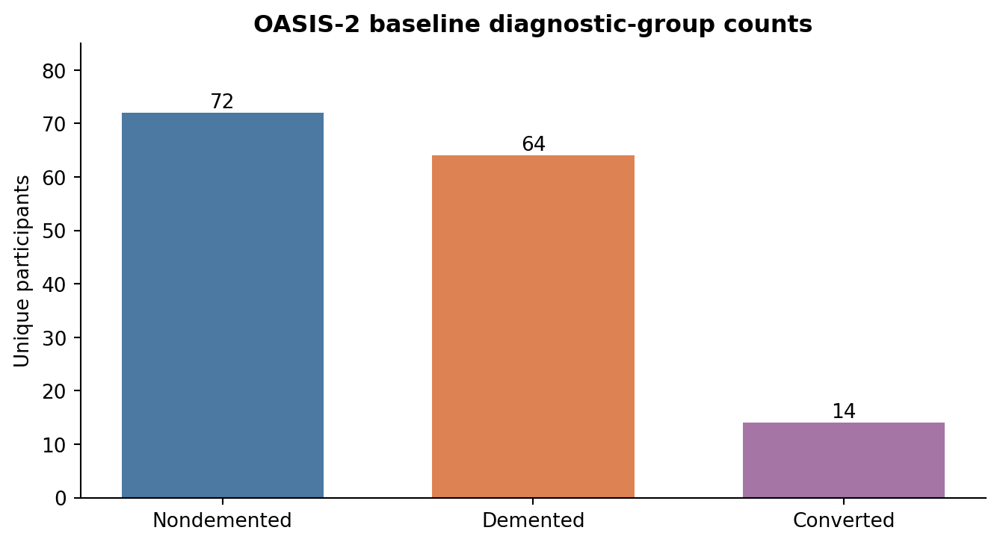
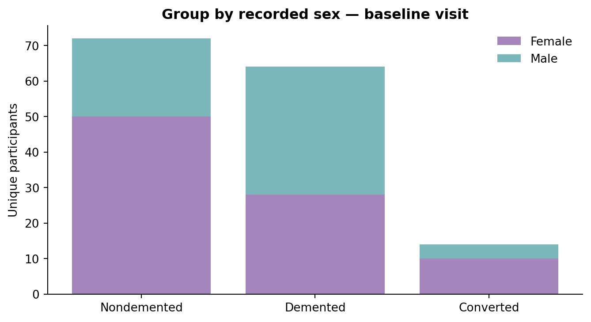
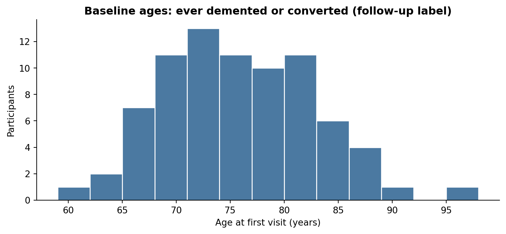
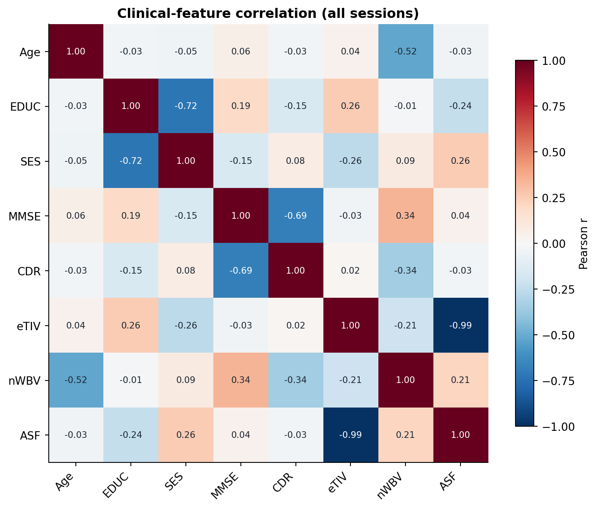
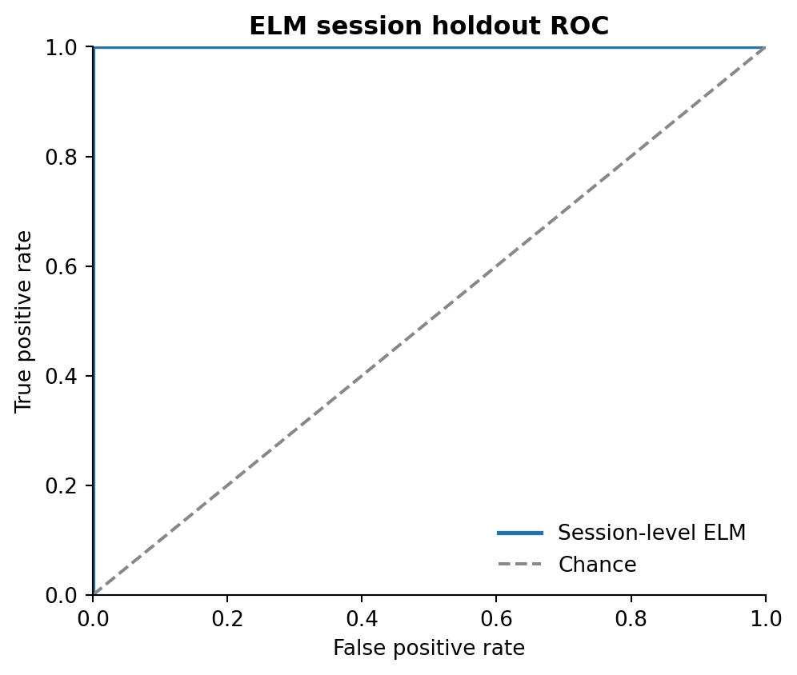

<div align="center">


# Extreme Learning Machines for Alzheimer’s Disease Identification

### Companion implementation · OASIS-2 longitudinal cohort · Reproducible experiments


[Quick start](#quick-start) · [Results](#study-results) · [Figures](#study-figures) · [Methods](docs/METHODS.md) · [Data access](data/README.md)

</div>

## The study

Companion research code implementing the methods in **Raghavan, Suma & Ganesh (2023)**, *Assessment of Neuroimaging Data and Identification of Alzheimer's Disease Using Extreme Learning Machines*, **Journal of Machine Learning for Modeling and Computing** 4(1):77–93.

The project analyzes **373 MRI-session records for 150 OASIS-2 participants**. It provides data checks, exploratory analysis, clinical-feature correlations, forward feature selection, an extreme learning machine (ELM), seven conventional classifiers, reproducible experiments, tests, and publication-ready figures. This is an independently developed companion implementation, not an official source-code release from the paper's authors.

## Quick start

```bash
git clone https://github.com/YOUR_USERNAME/oasis-elm-companion-code.git
cd oasis-elm-companion-code
python -m venv .venv
source .venv/bin/activate  # Windows: .venv\Scripts\activate
python -m pip install -r requirements.txt
```

**Dataset:** Obtain OASIS-2 longitudinal demographics through the [official OASIS access process](https://sites.wustl.edu/oasisbrains/request-access/) and save the spreadsheet as `data/raw/oasis_longitudinal_demographics.xlsx`. OASIS access and redistribution are subject to the provider's data-use terms. The private research archive supplied with this project already contains the input file.

```bash
python scripts/ingest_xlsx.py data/raw/oasis_longitudinal_demographics.xlsx
bash scripts/run_all.sh
```

This command regenerates machine-readable predictions and statistics, ROC curves, model comparisons, study figures, and the rendered analysis report. Run `PYTHONPATH=src python -m unittest discover -s tests -v` for tests, or `python scripts/verify_results.py` to validate saved predictions against performance metrics.

### Targeted runs

```bash
# ELM with train-only forward selection and a 60-session held-out test set
PYTHONPATH=src python -m oasis_repro.session_holdout --root . --seed 42

# Participant-disjoint nested cross-validation, feature selection and tuning
PYTHONPATH=src python -m oasis_repro.nested --root . --experiment group_subject_no_cdr
```

## Study results

| Evaluation | Accuracy | Sensitivity | Specificity | F1 | ROC AUC |
|---|---:|---:|---:|---:|---:|
| **ELM · session holdout (60 sessions)** | **98.33%** | 0.9615 | 1.0000 | 0.9804 | 1.0000 |
| ELM · grouped 5-fold CV, CDR included | 97.32% | 0.9521 | 0.9895 | 0.9686 | 0.9919 |
| ELM · grouped 5-fold CV, CDR excluded | 74.70% | 0.6644 | 0.8105 | 0.6953 | 0.8200 |
| ELM · nested CV, CDR excluded | 81.55% | 0.6986 | 0.9053 | 0.7669 | 0.8781 |

The session holdout uses a stratified *session-level* split, with 276 training and 60 test sessions. It selects **CDR, eTIV, EDUC, MMSE, nWBV** by forward selection on the training portion, then fits a **64-neuron tanh ELM with pseudoinverse output weights**. Its 59 correct predictions yield 98.33% accuracy. Because 44 participants have sessions in both partitions, this result concerns held-out **sessions**, not previously unseen participants. The grouped/nested evaluations are included to measure a different generalization setting. See [all metrics and all eight models](docs/RESULTS.md) and [full methods](docs/METHODS.md).

## Study figures

| Participant groups | Baseline sex distribution |
|:---:|:---:|
|  |  |
| Age distribution | Clinical-feature correlations |
|  |  |

| Session holdout confusion matrix | ELM ROC curve |
|:---:|:---:|
|  |  |

Figures are provided as PNG and editable SVG. Additional ROC and classifier-comparison plots are in `results/figures/`.

## Repository structure

```text
├── src/oasis_repro/          # Data contracts, ML models, ELM, tuning, experiments, figures
├── data/                     # Authorized input files (local), data dictionary/access guide
├── results/
│   ├── figures/              # PNG and SVG plots
│   ├── tables/               # Computed metrics, feature-selection traces, fold statistics
│   ├── metrics/              # JSON summaries and dataset statistics
│   └── predictions/          # Session-level predictions (local research copy)
├── docs/                     # Methods, results, data dictionary, model card
├── scripts/                  # Ingest, run all, verify outputs
├── tests/                    # Unit tests for data, splits, estimators and metrics
├── .github/workflows/        # Continuous integration tests
└── CITATION.cff
```

## Reproducibility

All training uses fixed random seeds. Data imputation and scaling are learned inside training folds. Participant-disjoint evaluations use `StratifiedGroupKFold` and keep a subject's visits together. Features and hyperparameters are selected only from each outer training fold in the nested track. Every score is recomputed from saved predictions. Outputs are **research classifiers on derived demographic/clinical MRI measures**, not a diagnostic service or a clinical device.

**Attribution:** Raghavan, Suma & Ganesh (2023), and Marcus et al. (2010), [OASIS-2](https://sites.wustl.edu/oasisbrains/home/oasis-2/). Data were provided in part by OASIS-2 (principal investigators D. Marcus, R. Buckner, J. Csernansky, and J. Morris). Source code is MIT licensed; OASIS data and the journal PDF are governed by their respective terms.
