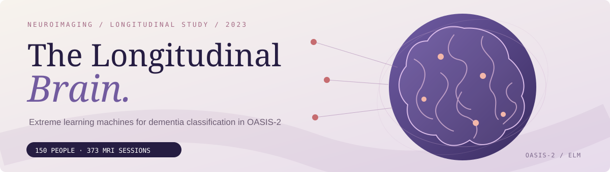
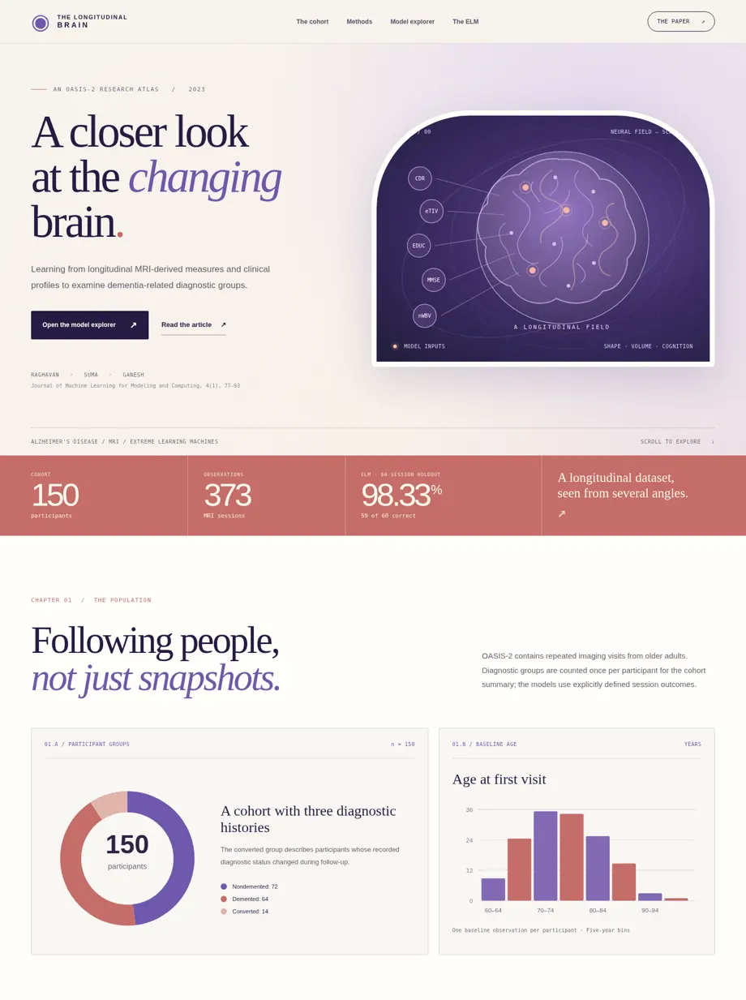

<div align="center">



# Assessment of Neuroimaging Data and Identification of Alzheimer's Disease Using Extreme Learning Machines

**Research code for the OASIS-2 longitudinal MRI study**

Dharini Raghavan · K. V. Suma · Puneeth N. Ganesh

[](#get-started)
[](data/README.md)
[](.github/workflows/repro.yml)
[](https://doi.org/10.1615/JMachLearnModelComput.2023048413)

**[Explore the interactive research atlas](docs/index.html)** &nbsp; · &nbsp; **[Read the paper](https://doi.org/10.1615/JMachLearnModelComput.2023048413)** &nbsp; · &nbsp; [Methods](docs/METHODS.md) &nbsp; · &nbsp; [Results](docs/RESULTS.md)

</div>

## The study

This repository accompanies our study of dementia-related diagnostic groups using clinical measurements and neuroimaging-derived volumetric features from the longitudinal OASIS-2 cohort. It provides the complete experimental pipeline for data preparation, descriptive analysis, feature selection, extreme learning machine (ELM) training, benchmark classifiers, and evaluation.

The dataset contains **150 participants** observed over **373 MRI sessions**. At baseline, the cohort includes **72 nondemented**, **64 demented**, and **14 converted** participants. The implementations use fixed random seeds and save evaluation settings, predictions, and aggregate measurements for each experiment.

## Explore the results

The accompanying project page has a different visual identity from our other research repositories. Designed as a compact neuroimaging atlas, it includes a longitudinal cohort view, age distribution, interactive classifier leaderboard, confusion matrices, ROC curves, and an ELM activation explorer. Charts are generated from saved experimental outputs.

<div align="center">
<a href="docs/index.html"></a>
</div>

### ELM experiments

| Evaluation setting | Accuracy | Sensitivity | Specificity | F1 | ROC AUC |
|:--|--:|--:|--:|--:|--:|
| 60-session ELM holdout | **98.33%** | 0.9615 | 1.0000 | 0.9804 | 1.0000 |
| Participant-disjoint CV, with CDR | 97.32% | 0.9521 | 0.9895 | 0.9686 | 0.9919 |
| Participant-disjoint CV, without CDR | 74.70% | 0.6644 | 0.8105 | 0.6953 | 0.8200 |
| Nested participant-disjoint CV, without CDR | 81.55% | 0.6986 | 0.9053 | 0.7669 | 0.8781 |

The 60-session holdout classifies **59 of 60 visits correctly** with five selected predictors—CDR, eTIV, EDUC, MMSE, and nWBV—and 64 tanh hidden units. It reproduces the manuscript's reported **98.3% accuracy** at one decimal place. The manuscript also reports sensitivity **0.956**, specificity **0.962**, F1 **0.972**, and ROC AUC **0.84**; those values are not identical to the metrics computed for this holdout. Each evaluation therefore retains its own saved confusion matrix and ROC curve. Session-level evaluations may share participants between training and testing, whereas participant-disjoint folds do not.

## Get started

Use Python 3.10 or newer. From the repository root:

```bash
python -m venv .venv
source .venv/bin/activate         # Windows: .venv\Scripts\activate
python -m pip install -r requirements.txt
```

Obtain the OASIS-2 longitudinal demographic workbook from the [OASIS project](https://sites.wustl.edu/oasisbrains/request-access/) and save it as `data/raw/oasis_longitudinal_demographics.xlsx`. The public version of this repository does not redistribute individual participant records.

```bash
python scripts/ingest_xlsx.py data/raw/oasis_longitudinal_demographics.xlsx
bash scripts/run_all.sh
```

The pipeline creates the cohort inventory, model tables, prediction manifests, clinical figures, ELM ROC curves, and the results report. To validate saved outputs:

```bash
python -m unittest discover -s tests -v
python scripts/verify_results.py
```

To regenerate the GitHub Pages site from the saved aggregate results:

```bash
python scripts/build_site.py
```

For public hosting, choose **Settings → Pages → Deploy from a branch → `main` → `/docs`**.

## Repository guide

| Location | Contents |
|---|---|
| [`src/oasis_repro/`](src/oasis_repro/) | ELM estimator, feature preparation, model training, evaluation and figure generation. |
| [`scripts/`](scripts/) | One-command experiments, ingestion, verification and site builder. |
| [`results/tables/`](results/tables/) | Computed model comparisons, fold metrics and experiment summaries. |
| [`results/figures/`](results/figures/) | Publication-style charts and vector graphics. |
| [`docs/index.html`](docs/index.html) | Interactive project page built from aggregate model results. |
| [`docs/METHODS.md`](docs/METHODS.md) | Model configurations, data partitioning and evaluation procedures. |
| [`docs/RESULTS.md`](docs/RESULTS.md) | Numerical summaries and additional experiments. |
| [`docs/DATA_GOVERNANCE.md`](docs/DATA_GOVERNANCE.md) | Data provenance and handling. |

## Citation

**D. Raghavan, K. V. Suma, and P. N. Ganesh.** *Assessment of Neuroimaging Data and Identification of Alzheimer's Disease Using Extreme Learning Machines.* Journal of Machine Learning for Modeling and Computing, 4(1):77–93, 2023. [https://doi.org/10.1615/JMachLearnModelComput.2023048413](https://doi.org/10.1615/JMachLearnModelComput.2023048413)

```bibtex
@article{raghavan2023assessment,
  title   = {Assessment of Neuroimaging Data and Identification of
             Alzheimer's Disease Using Extreme Learning Machines},
  author  = {Raghavan, Dharini and Suma, K. V. and Ganesh, Puneeth N.},
  journal = {Journal of Machine Learning for Modeling and Computing},
  volume  = {4},
  number  = {1},
  pages   = {77--93},
  year    = {2023},
  doi     = {10.1615/JMachLearnModelComput.2023048413}
}
```

The OASIS-2 dataset is credited to the OASIS project and its originating investigators. This code is intended for research and education, not independent clinical diagnosis or treatment.
