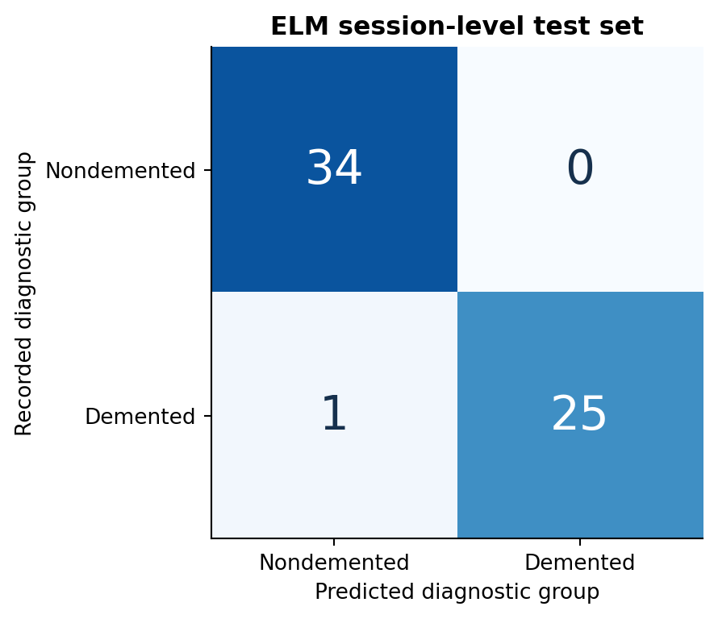

# Results

## Dataset

OASIS-2 cohort: **150 participants** and **373 MRI sessions**. Participant diagnostic groups: Nondemented 72, Demented 64, Converted 14.

## ELM session holdout

| Metric | Value |
|---|---:|
| Accuracy | **98.33%** (59/60) |
| Sensitivity | 0.9615 |
| Specificity | 1.0000 |
| Precision | 1.0000 |
| F1 | 0.9804 |
| ROC AUC | 1.0000 |
| Confusion matrix (TN/FP/FN/TP) | 34/0/1/25 |
| Selected features | CDR, eTIV, EDUC, MMSE, nWBV |
| Train/test participant overlap | 44 |

## Eight-model evaluation: participant-disjoint 5-fold CV, without CDR

| Model | Accuracy | Sensitivity | Specificity | F1 | ROC AUC |
|---|---:|---:|---:|---:|---:|
| LR | 84.52% | 0.8014 | 0.8789 | 0.8182 | 0.9219 |
| kNN | 73.81% | 0.6233 | 0.8263 | 0.6741 | 0.8145 |
| NB | 82.14% | 0.6986 | 0.9158 | 0.7727 | 0.9000 |
| SVM | 80.06% | 0.6507 | 0.9158 | 0.7393 | 0.8715 |
| DT | 81.25% | 0.7397 | 0.8684 | 0.7742 | 0.7966 |
| RFC | 81.85% | 0.7192 | 0.8947 | 0.7749 | 0.8634 |
| GB | 81.25% | 0.7466 | 0.8632 | 0.7758 | 0.8748 |
| ELM | 74.70% | 0.6644 | 0.8105 | 0.6953 | 0.8200 |

## ELM outcomes by evaluation protocol

| Protocol | Samples | Accuracy | Sensitivity | Specificity | F1 | ROC AUC |
|---|---:|---:|---:|---:|---:|---:|
| Baseline-only, ever-demented grouping | 150 | 64.67% | 0.5769 | 0.7222 | 0.6294 | 0.7215 |
| Visit CDR target, grouped | 373 | 77.21% | 0.7186 | 0.8155 | 0.7385 | 0.8430 |
| Recorded group, CDR excluded, grouped | 336 | 74.70% | 0.6644 | 0.8105 | 0.6953 | 0.8200 |
| Recorded group, CDR included, grouped | 336 | 97.32% | 0.9521 | 0.9895 | 0.9686 | 0.9919 |
| Recorded group, CDR included, session CV | 336 | 98.51% | 0.9795 | 0.9895 | 0.9828 | 0.9983 |

## Nested ELM: subject-independent selection and tuning

| Experiment | Samples | Accuracy | Sensitivity | Specificity | F1 | ROC AUC |
|---|---:|---:|---:|---:|---:|---:|
| `baseline_ever` | 150 | 70.67% | 0.6282 | 0.7917 | 0.6901 | 0.7863 |
| `group_subject_no_cdr` | 336 | 81.55% | 0.6986 | 0.9053 | 0.7669 | 0.8781 |

## Reading the evaluations

The session-level holdout and participant-disjoint cross-validation answer different prediction questions. Sessions from the same person occur in both partitions in the session holdout. CDR is a recorded clinical dementia rating strongly related to the diagnostic outcome. Therefore the high CDR-inclusive scores are not equivalent to MRI-derived-feature-only prediction on unseen people.

The OASIS demographic spreadsheet includes derived neuroimaging volumes and clinical data; original voxel-level MRI images are not inputs to this program. This software is for research and is not a clinical decision tool.

See [Methods](METHODS.md) for exact class definitions, partition rules, model hyperparameters, feature selection and evaluation. Saved metrics appear in `results/metrics/`; model comparison tables in `results/tables/`; row-level predictions in the local complete research archive.
